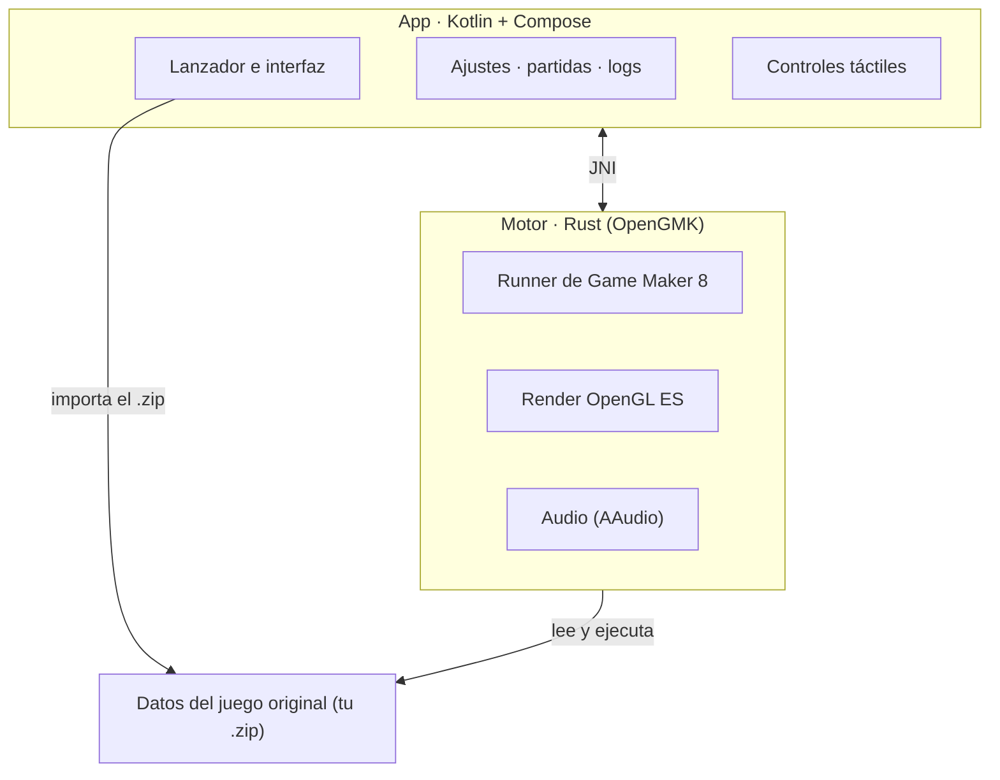

# Pokémon Reloaded en Android

Ejecuta **Pokémon Reloaded** en Android sin emulador de Windows de por medio. Lo mantiene
[@Klisee](https://github.com/Klisee), para la comunidad.

## Qué es esto, en realidad

Lo de "port" es un decir, y conviene aclararlo. Pokémon Reloaded es un juego hecho en Game Maker 8
para Windows, y aquí **no se ha reescrito ni recompilado nada**. Lo que hace esta app es
**ejecutar el juego original tal cual**, con sus archivos intactos, sobre
[OpenGMK](https://github.com/OpenGMK/OpenGMK): una reimplementación nativa en Rust del motor de
Game Maker 8.

Dicho de otro modo: no hay Wine, no hay Windows emulado, no hay capa de traducción. El motor está
escrito para Android y compilado para el móvil, así que el juego corre prácticamente como un nativo.
Lo único que se ha "porteado" son las tripas del motor, no el juego.

La app sí aporta todo lo de fuera del juego: importar el juego desde un `.zip`, controles táctiles,
ajustes, gestión de partidas y logs. El juego en sí no se toca.

## Cómo funciona

- **Importar.** Le das a Importar y eliges el `.zip` del juego. La app lo descomprime en su propio
  almacenamiento privado, así que no depende de permisos de almacenamiento ni de dónde lo tengas
  guardado.
- **Ejecutar.** El motor (OpenGMK, en Rust) se carga como librería nativa y arranca el runner de
  Game Maker 8 sobre los datos del juego. El render va por OpenGL ES y el audio por AAudio.
- **Controles.** La capa táctil no es fija: cambia según el estado del juego, así que en el mapa
  tienes una cruceta y en los menús otra cosa. Cada botón pulsa una tecla del juego, y puedes
  reasignar cualquiera desde Ajustes → Mando → Controles. También funciona un mando real, detectado solo.
- **Partidas.** Se leen y escriben en la carpeta del juego. Desde Ajustes → Partidas puedes verlas,
  exportarlas, importarlas, borrarlas y mover una de una ranura a otra. Si jugabas en PC, tu partida
  entra por aquí.
- **Salir y volver.** Al mandar la app a segundo plano, el bucle se detiene y el audio se corta de
  verdad; al volver, sigue donde estaba en vez de quedarse en negro.
- **Logs.** Si algo va mal, la app escribe un log y lo puedes compartir como archivo de texto desde
  Ajustes → Logs, sin perderlo al reiniciar el móvil.

## Cómo está montado



La app y el motor son dos mundos separados que hablan por JNI. El motor no sabe de Android ni de
interfaz: solo sabe ejecutar el juego. La app no sabe de Game Maker: solo lo lanza y lo envuelve.
Esa separación es la que permite tocar la interfaz sin romper el motor, y viceversa.

## Qué necesitas

Los archivos originales del juego, que están en el blog de **F3R**:
[pokemon-reloaded.blogspot.com](https://pokemon-reloaded.blogspot.com/)

El repo no incluye ningún asset del juego, y eso es justo lo que lo mantiene limpio.

## Cómo se usa

1. Instala el APK de la última release.
2. Consigue el juego en un `.zip` y dale a **Importar** (o usa **Descargar** para abrir el blog).
3. **Jugar**. Si ya tenías partida en el PC, tráela desde Ajustes → Partidas.

## Estado

Está en beta y se nota: puede petar. Si algo falla, guarda un log desde Ajustes → Logs y ábrelo como
issue.

Ya resuelto:

- **La pantalla negra en móviles con GPU PowerVR** (MediaTek Helio y similares). El motor enlazaba el
  VAO/VBO/programa una sola vez y daba por anulado el búfer tras cada dibujo: en GPUs diferidas
  (TBDR) eso dejaba al procesador de vértices leyendo memoria descartada y no se pintaba nada. Ahora
  se enlazan en cada dibujo, no se invalida el búfer, el bloque de uniforms `std140` tiene los
  offsets correctos y los atlases se suben por lotes — con esto último el arranque pasó de ~85 s a
  un momento. Gracias a **Alexpix0 (Armando)**, que lo encontró y probó. (Los detalles del
  diagnóstico están en el historial de commits.)
- **El escalado en combate**, que se quedaba con la cámara descolocada.
- **El movimiento Vuelo**, que no llegaba a conectar.
- **La XP infinita** al abrir la mochila tras debilitar a un Pokémon.
- **El cierre en combates dobles** al cambiar de Pokémon.

Lo que ahora mismo da problemas, y resolveré después:

- **El audio se corta** en algunos móviles al mezclar música y efectos.

Y por ir haciendo, sin orden:

- Poner imágenes propias (pixel art) a más botones táctiles.
- Más ajustes de rendimiento en móviles modestos.
- Revisar la compatibilidad con mandos de todo tipo.

## Compilar

Cada arquitectura lleva su propio APK (el motor es nativo). `arm64-v8a` es la de por defecto:

```
# El motor (Rust) y su .so para Android
cd src/OpenGMK
cargo ndk -t arm64-v8a --platform 29 build -p gm8emulator --release
cargo ndk -t armeabi-v7a --platform 29 build -p gm8emulator --release
cargo ndk -t x86_64 --platform 29 build -p gm8emulator --release

# La app: un APK por arquitectura
cd ../../android
./build.sh :app:assembleRelease
./build.sh :app:assembleRelease -PtargetAbi=armeabi-v7a
./build.sh :app:assembleRelease -PtargetAbi=x86_64
```

El workflow `.github/workflows/build-apks.yml` compila las tres en CI al publicar un tag.

## Créditos

- **Pokémon Reloaded** es obra de **F3R Productions**: [el blog del juego](https://pokemon-reloaded.blogspot.com/)
- **OpenGMK**, la reimplementación del motor sin la que esto no existiría: [github.com/OpenGMK/OpenGMK](https://github.com/OpenGMK/OpenGMK)
- **LixarXDX**: por el rediseño de los controles táctiles y los controles clásicos, la base de la personalización de esta versión.
- **Alexpix0 (Armando)**: por el arreglo del renderizado que resolvió la **pantalla negra en móviles con GPU PowerVR** (enlazar VAO/VBO/programa en cada dibujo, quitar la invalidación del búfer que rompía en GPUs diferidas, corregir el `std140` del bloque de uniforms y subir los atlases por lotes, que además dejó el arranque muchísimo más rápido). [Su PR](https://github.com/Klisee/pokemon-reloaded-android/pull/2)
- **Google Sans Flex**, la tipografía de la app

Pokémon es una marca de Nintendo, Game Freak y Creatures. Este proyecto no está afiliado ni
respaldado por ellos.
